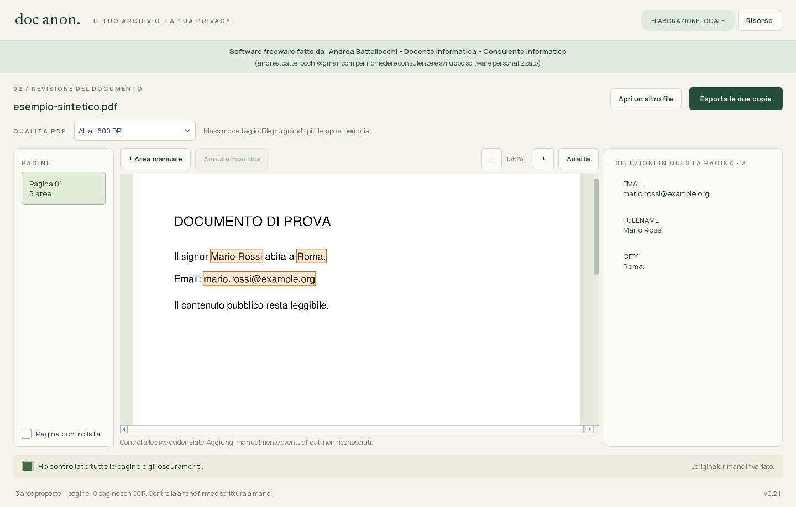

# Doc Anon

Applicazione Windows per individuare dati personali, revisionare gli oscuramenti sulle pagine e creare due PDF locali. Primo download del modello; utilizzo successivo offline. Nessun account, API, server HTTP o database.

Software freeware fatto da: **Andrea Battellocchi - Docente Informatica - Consulente Informatico** (andrea.battellocchi@gmail.com per richiedere consulenze e sviluppo software personalizzato).



La repository contiene i sorgenti e gli script per generare eseguibile, ZIP e installer. L'installer pronto è disponibile nelle [release](https://github.com/yellowelise/doc_anon/releases/latest). I modelli scaricati e i documenti locali non sono versionati; per ricompilare i pacchetti seguire la sezione **Build Windows**.

## Installazione Windows

**[Scarica l'installer Windows 0.2.1 (x64)](https://github.com/yellowelise/doc_anon/releases/download/v0.2.1/DocAnon-Setup-0.2.1-x64.exe)** · [Checksum SHA-256](https://github.com/yellowelise/doc_anon/releases/download/v0.2.1/DocAnon-Setup-0.2.1-x64.exe.sha256)

Avviare **`DocAnon-Setup-0.2.1-x64.exe`** e seguire la procedura in italiano. Il programma viene installato per l'utente corrente, normalmente in `%LOCALAPPDATA%\Programs\Doc Anon`, senza richiedere privilegi di amministratore. Viene creato il collegamento nel menu Start; quello sul desktop è facoltativo. Il nuovo installer mantiene la stessa identità dell'app e aggiorna le versioni precedenti conservando le risorse scaricate.

L'installer include tutte le librerie e il motore OCR. Al primo avvio dell'app scegliere **Scarica e prepara** per il modello e i dati OCR (circa 1,3 GB). Questi restano separati in `%LOCALAPPDATA%\DocAnon`. I successivi avvii funzionano offline.

La disinstallazione è disponibile da **Impostazioni di Windows → App → Doc Anon**. Rimuove il programma e i collegamenti, conservando i modelli scaricati e i documenti esportati. Chiudere l'app prima di reinstallare o aggiornare, dopo aver esportato la revisione corrente. Installer ed eseguibile non sono firmati digitalmente.

## Avvio dell'eseguibile

1. Estrarre **tutta** la cartella dello ZIP `dist/DocAnon-Windows-x64.zip`.
2. Avviare `DocAnon/DocAnon.exe`. La cartella `_internal` deve rimanere accanto all'eseguibile.
3. Al primo avvio scegliere **Scarica e prepara**. Occorrono circa 1,3 GB di download e almeno 1,6 GB liberi per le risorse, oltre allo spazio dell'app.
4. Quando compare **Pronto**, si può scollegare Internet. Aprire un PDF (anche scansionato), TXT o Markdown UTF-8.
5. Controllare le proposte pagina per pagina. Selezionare un'area per correggere le iniziali, spostarla o modificarne posizione e dimensioni. **Area manuale** permette di disegnare un nuovo rettangolo; **Rimuovi oscuramento** mantiene visibile quell'area; **Annulla modifica** ripristina fino a 30 modifiche.
6. Confermare di aver controllato tutte le pagine e scegliere **Esporta le due copie**.

Ogni esportazione crea una nuova sottocartella nella destinazione scelta, con `nome_lite.pdf` (iniziali per i nomi, omissioni per gli altri dati) e `nome_anonimo.pdf` (`[omesso]` per tutte le aree selezionate). L'originale non viene modificato. Le iniziali non garantiscono l'anonimato: la copia lite è intenzionalmente meno oscurata.

## Qualità del PDF e anteprima

Il selettore **Qualità PDF** si trova sopra la pagina e vale per entrambe le copie: **Compatta · 150 DPI** per file leggeri, **Standard · 300 DPI** (predefinita) per lettura e stampa, **Alta · 600 DPI** per il massimo dettaglio. La compressione delle immagini è senza perdita. Qualità più alte richiedono più tempo, memoria e spazio; non recuperano dettagli assenti in una scansione originale.

L'anteprima è indipendente dalla qualità di esportazione. I pulsanti `+`, `−`, **Adatta** e `Ctrl` + rotella controllano lo zoom. Ingrandendo o scorrendo la pagina, l'app ridisegna dal documento originale solo la porzione visibile, tenendo conto della densità del monitor. Le coordinate degli oscuramenti restano in punti PDF e non cambiano con lo zoom. Il ridisegno viene accorpato dopo 120 ms e non si sovrappone alle elaborazioni del documento.

Per contenere l'uso di memoria, l'esportazione ha un limite di circa 40 milioni di pixel per pagina (sufficiente per un A4 a 600 DPI). Per formati molto grandi, il selettore mostra quante pagine saranno limitate e la risoluzione minima effettiva. Le immagini compresse di una singola variante possono occupare al massimo 256 MiB; oltre il limite, scegliere una qualità inferiore o dividere il documento. La porzione ad alta risoluzione dell'anteprima è limitata a circa 8 milioni di pixel e la pagina di base a 3 milioni.

Le risorse vengono conservate in `%LOCALAPPDATA%\DocAnon`. Non si scaricano aggiornamenti all'avvio. Il pulsante **Risorse → Verifica / ripara risorse** riesegue la preparazione su richiesta, riutilizzando i file integri e riprendendo i download incompleti. Il modello Rizzo è fissato alla revisione `a1c3c83827eca22e9675e30c1111c4641caf5901` (v1.5.0); non viene eseguito codice scaricato dal repository del modello.

## Requisiti e limiti

- Windows 10/11 x64; elaborazione su CPU. Consigliati 8 GB RAM o più; i requisiti effettivi dipendono dal documento. Non è necessaria una GPU.
- PDF fino a 25 MB e 250 pagine, massimo 40 pagine con OCR e 500.000 caratteri estratti. OCR italiano Tesseract 5, con limiti di tempo e memoria per pagina.
- PDF cifrati/protetti non supportati. DOCX, immagini singole e scrittura a mano non hanno un percorso di importazione dedicato.
- Firme, annotazioni, immagini, scansioni difficili e dati non riconosciuti richiedono controllo visivo. L'assenza di selezioni non certifica l'assenza di dati personali.
- Le esportazioni ricostruiscono le pagine da pixel già oscurati; non copiano gli oggetti PDF originali, allegati o metadati. La ricerca resta disponibile per il testo nativo non oscurato, non per le scansioni. La rasterizzazione può aumentare il peso e ridurre la qualità dello zoom; link, moduli e firme digitali originali non vengono preservati.
- La revisione rimane in memoria e non viene salvata come progetto. Alla chiusura occorre aver esportato. I nomi dei file sono scelti dall'utente: evitare dati personali nel nome quando si condividono le copie.
- Le esportazioni sono normali file PDF locali, non cifrati. L'app non invia documenti in rete; eventuali cartelle sincronizzate (OneDrive, ecc.) seguono le impostazioni del computer.
- Distribuzione non firmata digitalmente. La verifica su una macchina Windows pulita resta distinta dai test sul computer di sviluppo.

## Sviluppo

Python 3.12 x64 e Tesseract 5 x64 sono necessari soltanto per sviluppare/ricompilare. L'eseguibile include Python, Qt, PyTorch CPU e il motore Tesseract; l'utente finale scarica solo il modello e i dati OCR.

```powershell
python -m venv .venv
.venv/Scripts/python.exe -m pip install torch==2.10.0 --index-url https://download.pytorch.org/whl/cpu
.venv/Scripts/python.exe -m pip install -r requirements-dev.txt
.venv/Scripts/python.exe main.py
```

Il progetto utilizza Python/PySide6 per l'interfaccia nativa, PyMuPDF per le pagine, il modello Rizzo via Transformers/PyTorch e Tesseract per l'OCR. Il codice di elaborazione PDF deriva da Level DOCS; i rilevatori di formati Rizzo sono inclusi con la loro licenza MIT. Non dipende dall'installazione di Level DOCS e non usa Next.js.

## Build Windows

```powershell
powershell -ExecutionPolicy Bypass -File scripts/build.ps1
```

L'opzione `-TesseractDirectory` specifica una diversa installazione Tesseract x64. Lo script copia eseguibile, DLL e documentazione nella distribuzione, esegue i test senza modello, crea `dist/DocAnon/DocAnon.exe` e lo ZIP. Non include i pesi del modello nella distribuzione. `requirements-lock.txt` registra le versioni dell'ambiente usato per il build iniziale.

Per creare anche l'installer dalla distribuzione già costruita, installare [Inno Setup](https://jrsoftware.org/isdl.php) ed eseguire `scripts/build-installer.ps1`. Il build iniziale usa Inno Setup 7.1.1 x64. È possibile specificare `-IsccPath` per un compilatore in una posizione diversa. La configurazione è in `installer/DocAnon.iss`; i checksum dei pacchetti sono in `dist/CHECKSUMS.sha256`.

Il ciclo di verifica è ripetibile con `scripts/test-installer.ps1 -ResourcesDirectory PERCORSO_RISORSE`: installa in una cartella temporanea del progetto, controlla reinstallazione, contenuto e collegamento Start, esegue la prova offline e disinstalla. Si interrompe se Doc Anon risulta già installato, per non alterare l'installazione dell'utente. Report dell'ultima verifica: `verification/installer-test.json`.

Se Doc Anon è già installato, creare una variante di prova con `scripts/build-installer.ps1 -TestBuild`, poi eseguire `scripts/test-installer.ps1 -ResourcesDirectory PERCORSO_RISORSE -Isolated`. Questa variante ha una diversa identità di installazione e lo stesso codice e payload; viene salvata soltanto in `.test-data/installer-build` e non va distribuita come aggiornamento.

## Verifica

```powershell
.venv/Scripts/python.exe -m pytest -m 'not integration'
$env:DOC_ANON_DATA_DIR = Join-Path (Get-Location) '.test-data/resources'
.venv/Scripts/python.exe scripts/prepare_resources.py
.venv/Scripts/python.exe -m pytest
```

I test d'integrazione usano il modello reale su un PDF sintetico e su una scansione sintetica, bloccando `socket.connect` e la risoluzione DNS durante caricamento, inferenza ed esportazione. Gli altri test verificano che testo oscurato, pixel originali, allegati e metadati non sopravvivano nelle copie; che gli originali non vengano sovrascritti; che l'interfaccia consenta modifiche e annullamento; e che download danneggiati non siano attivati.

Variabili opzionali: `DOC_ANON_DATA_DIR` cambia la cartella delle risorse; `DOC_ANON_TESSERACT` è gestita dall'app per puntare al motore incluso. Non sono richieste chiavi API. `HF_HUB_OFFLINE` e `TRANSFORMERS_OFFLINE` sono sempre impostate durante l'elaborazione.

Per verificare anche l'eseguibile compilato, dopo aver preparato le risorse in `.test-data/resources`, eseguire `scripts/verify_package.ps1`. Avvia il pacchetto in modalità di prova nascosta, crea soltanto documenti sintetici e scrive report e anteprime in `.test-data/packaged`. È disponibile anche `DocAnon.exe --self-test CARTELLA_OUTPUT`; in questa modalità le chiamate di rete vengono bloccate nel processo.

## Riferimenti

- [Modello Rizzo](https://huggingface.co/rizzoaiacademy/rizzo-pii-0.3B/tree/a1c3c83827eca22e9675e30c1111c4641caf5901)
- [Rilevatori Rizzo, revisione di origine](https://github.com/Rizzo-AI-Academy/rizzo-pii/tree/30d6f9c675e245bc8494df959adaeaa9d8de35c7)
- [Qt for Python](https://doc.qt.io/qtforpython-6/)
- [Tesseract Windows](https://github.com/UB-Mannheim/tesseract/wiki)

Le attribuzioni e i testi delle licenze inclusi sono descritti in `THIRD_PARTY_NOTICES.md` e `vendor/`.
